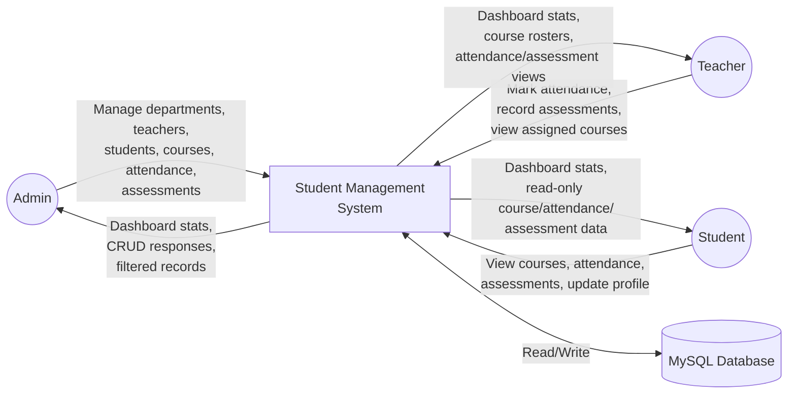
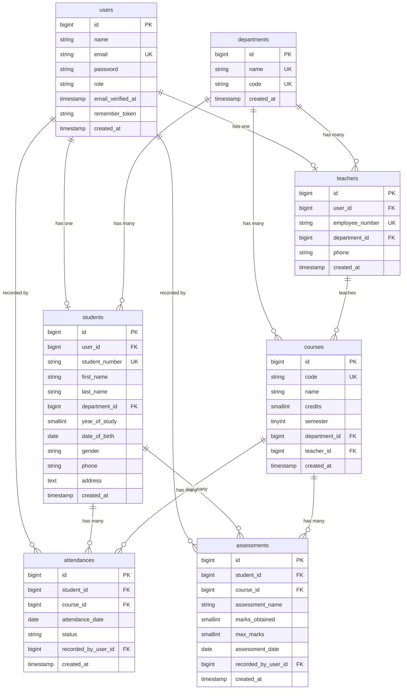

# Student Management System (SMS)

## 1. Project Overview and Scope

The **Student Management System (SMS)** is a web-based application for university academic administration. It provides three role-based portals — **Admin**, **Teacher**, and **Student** — to manage departments, faculty, students, courses, attendance, and assessments.

**Scope:**
- Manage academic departments and their associated faculty, students, and courses.
- Record and track student attendance on a per-course, per-date basis.
- Record continuous assessment marks (quizzes, midterms, assignments, finals) with automatic percentage calculation.
- Provide students with a read-only portal to view their courses, attendance history, and assessment scores.
- Allow students to update their own contact information and password.

---

## 2. Functional and Non-Functional Requirements

### Functional Requirements

| ID | Requirement |
| :--- | :--- |
| FR-01 | **Multi-Role Authentication & Access Control**: Provide secure login and role-based access for Admin, Teacher, and Student roles using dedicated identifiers (Email, Employee ID, Student ID). |
| FR-02 | **Academic Structure & Records Management**: Allow Admins to manage (create, view, edit, delete) departments, courses, teachers, and student registrations. |
| FR-03 | **Course Attendance Tracking**: Enable Teachers to record attendance with validation against future dates and duplicate entries, while allowing Students to view attendance history and percentage. |
| FR-04 | **Assessment & Marks Management**: Allow Teachers to create, update, and manage assessment records (marks obtained, maximum marks, date) with transparent view access for Students. |
| FR-05 | **Student Self-Service Portal**: Provide Students self-service access to view enrolled courses, academic performance, and manage personal contact details and password. |
| FR-06 | **Role-Specific Dashboard Analytics**: Display tailored summary metrics and analytics for Admin (institutional counts), Teacher (course & record counts), and Student (enrolled courses & attendance). |

### Non-Functional Requirements

| ID | Requirement |
| :--- | :--- |
| NFR-01 | The application shall use server-side rendering with no client-side JavaScript framework dependency. |
| NFR-02 | Passwords shall be hashed using Bcrypt with 12 rounds. |
| NFR-03 | All form submissions shall be protected against CSRF attacks via Laravel's built-in CSRF tokens. |
| NFR-04 | The `role` field on users shall not be mass-assignable; roles are assigned server-side only via `User::createWithRole()`. |
| NFR-05 | All foreign key constraints shall use `restrictOnDelete()` to prevent orphaned records. |
| NFR-06 | Sessions shall be stored in the database. |

---

## 3. Technology Stack

| Layer | Technology Used |
| :--- | :--- |
| Backend | PHP |
| Framework | Laravel |
| Database | MySQL |
| Frontend | Blade Templates, Vanilla CSS |
| Authentication | Laravel Session Auth |
| Package Manager | Composer |

---

## 4. Directory and File Structure

```
student_management_sys/
├── app/
│   ├── Console/Commands/
│   │   └── CreateAdminCommand.php            # Artisan command to create admin user
│   ├── Http/
│   │   ├── Controllers/
│   │   │   ├── Controller.php                # Base controller
│   │   │   ├── Admin/
│   │   │   │   ├── DashboardController.php   # Admin dashboard stats
│   │   │   │   ├── CourseController.php       # Course CRUD
│   │   │   │   ├── DepartmentController.php  # Department CRUD
│   │   │   │   ├── StudentController.php     # Student CRUD
│   │   │   │   └── TeacherController.php     # Teacher CRUD
│   │   │   ├── Auth/
│   │   │   │   └── LoginController.php       # Login / Logout
│   │   │   ├── Student/
│   │   │   │   ├── DashboardController.php   # Student dashboard, courses, attendance, assessments
│   │   │   │   └── ProfileController.php     # Student profile update
│   │   │   └── Teacher/
│   │   │       ├── DashboardController.php   # Teacher dashboard and course views
│   │   │       ├── AttendanceController.php  # Attendance listing, create, store, edit, update, destroy
│   │   │       └── AssessmentController.php  # Assessment CRUD
│   │   ├── Middleware/
│   │   │   ├── EnsureUserIsAdmin.php         # Restricts routes to admin role
│   │   │   ├── EnsureUserIsTeacher.php       # Restricts routes to teacher role
│   │   │   └── EnsureUserIsStudent.php       # Restricts routes to student role
│   │   └── Requests/
│   │       ├── StoreAssessmentRequest.php
│   │       ├── StoreAttendanceRequest.php
│   │       ├── StoreCourseRequest.php
│   │       ├── StoreDepartmentRequest.php
│   │       ├── StoreStudentRequest.php
│   │       ├── UpdateAssessmentRequest.php
│   │       ├── UpdateCourseRequest.php
│   │       ├── UpdateDepartmentRequest.php
│   │       ├── UpdateStudentProfileRequest.php
│   │       └── UpdateStudentRequest.php
│   ├── Models/
│   │   ├── Assessment.php
│   │   ├── Attendance.php
│   │   ├── Course.php
│   │   ├── Department.php
│   │   ├── Student.php
│   │   ├── Teacher.php
│   │   └── User.php
│   └── Providers/
│       └── AppServiceProvider.php
├── bootstrap/
│   └── app.php                               # Middleware alias registration
├── database/
│   ├── migrations/
│   │   ├── create_users_table.php
│   │   ├── create_cache_table.php
│   │   ├── create_jobs_table.php
│   │   ├── create_departments_table.php
│   │   ├── create_teachers_table.php
│   │   ├── create_students_table.php
│   │   ├── create_courses_table.php
│   │   ├── create_attendances_table.php
│   │   └── create_assessments_table.php
│   └── seeders/
│       ├── DatabaseSeeder.php                # Runs all seeders below in order
│       ├── AdminSeeder.php                   # Admin account (only if none exists)
│       ├── DepartmentSeeder.php
│       ├── TeacherSeeder.php
│       ├── CourseSeeder.php
│       ├── StudentSeeder.php
│       ├── AttendanceSeeder.php
│       └── AssessmentSeeder.php
├── resources/
│   ├── css/
│   │   └── app.css                           # Design system (CSS variables, role themes, layout)
│   └── views/
│       ├── layouts/
│       │   └── app.blade.php                 # Master layout with role-based top navigation
│       ├── auth/
│       │   └── login.blade.php               # Login page
│       ├── components/
│       │   ├── flash-message.blade.php       # Success/error flash messages
│       │   └── form-error.blade.php          # Inline field validation errors
│       ├── admin/
│       │   └── dashboard.blade.php
│       ├── departments/
│       │   ├── index, create, edit, _form
│       ├── teachers/
│       │   ├── index, create, edit, show, _form
│       ├── students/
│       │   ├── index, create, edit, show, _form
│       ├── courses/
│       │   ├── index, create, edit, show, _form
│       ├── attendance/
│       │   ├── index, create, edit
│       ├── assessments/
│       │   ├── index, create, edit, _form
│       ├── student/
│       │   ├── dashboard.blade.php
│       │   ├── courses.blade.php
│       │   ├── attendance.blade.php
│       │   ├── assessments.blade.php
│       │   └── _profile_edit_form.blade.php
│       └── teacher/
│           └── dashboard.blade.php
├── routes/
│   └── web.php                               # All application routes
├── public/
│   ├── css/app.css                           # Compiled CSS asset
│   └── index.php                             # Web entry point
└── .env                                      # Environment configuration
```

---

## 5. Data Flow Diagrams

### 5.1 DFD Level 0 (Context Diagram)



### 5.2 DFD Level 1

```mermaid
flowchart TD
    Admin((Admin))
    Teacher((Teacher))
    Student((Student))
    DB[(MySQL Database)]

    subgraph P1 [1.0 Authentication]
        Login[Login / Logout]
    end

    subgraph P2 [2.0 Admin Management]
        DeptMgmt[2.1 Manage Departments]
        TeacherMgmt[2.2 Manage Teachers]
        StudentMgmt[2.3 Manage Students]
        CourseMgmt[2.4 Manage Courses]
        AdminAtt[2.5 View/Edit/Delete Attendance]
        AdminAssess[2.6 View/Edit/Delete Assessments]
    end

    subgraph P3 [3.0 Teacher Operations]
        TeacherDash[3.1 Teacher Dashboard]
        ViewCourses[3.2 View Assigned Courses]
        MarkAtt[3.3 Mark Attendance]
        RecordAssess[3.4 Record Assessments]
    end

    subgraph P4 [4.0 Student Portal]
        StudentDash[4.1 Student Dashboard]
        ViewStudentCourses[4.2 View Courses]
        ViewAttendance[4.3 View Attendance]
        ViewAssessments[4.4 View Assessments]
        UpdateProfile[4.5 Update Profile]
    end

    Admin --> Login
    Teacher --> Login
    Student --> Login
    Login <--> DB

    Admin --> DeptMgmt & TeacherMgmt & StudentMgmt & CourseMgmt & AdminAtt & AdminAssess
    DeptMgmt & TeacherMgmt & StudentMgmt & CourseMgmt & AdminAtt & AdminAssess <--> DB

    Teacher --> TeacherDash & ViewCourses & MarkAtt & RecordAssess
    TeacherDash & ViewCourses & MarkAtt & RecordAssess <--> DB

    Student --> StudentDash & ViewStudentCourses & ViewAttendance & ViewAssessments & UpdateProfile
    StudentDash & ViewStudentCourses & ViewAttendance & ViewAssessments & UpdateProfile <--> DB
```



---

## 6. Database Design and Entity Relationship Diagram

### ER Diagram



### Key Constraints

| Table | Constraint | Details |
| :--- | :--- | :--- |
| `attendances` | Unique composite | `(student_id, course_id, attendance_date)` — prevents duplicate attendance per student per course per day |
| `assessments` | Unique composite | `(student_id, course_id, assessment_name)` — prevents duplicate assessment names per student per course |
| `students` | Composite index | `(last_name, first_name)` — optimizes name-based searches |
| `students` | Index | `year_of_study` — optimizes year-based filtering |
| All FKs | On Delete | `restrictOnDelete()` — prevents deletion of referenced parent records |

---

## 7. Modules and Feature Breakdown

### 7.1 Authentication Module
- **Login page** with role selector (Student, Faculty, Admin).
- Students log in using their **student number**, teachers using their **employee number**, and admins using their **email**.
- Session regeneration on login, session invalidation on logout.
- Role verification ensures the logged-in user's role matches their selected role and that a corresponding profile (teacher/student) record exists.

### 7.2 Admin Module (`/admin/*`)
- **Dashboard:** Displays counts of total students, total faculty, departments, and courses.
- **Department Management:** Create, list, edit, and delete departments (name and code, both unique).
- **Teacher Management:** Create, list, view, edit, and delete teachers. Creating a teacher also creates the associated user account with the `teacher` role.
- **Student Management:** Create, list, view, edit, and delete students with department filter, year filter, and name/number search. Creating a student also creates the associated user account with the `student` role.
- **Course Management:** Create, list, edit, and delete courses. Each course belongs to a department and can be assigned to a teacher. Courses have a code, name, credits, and semester (1–8).
- **Attendance Oversight:** View all attendance records across courses with filters (department, course, date). Can edit and delete individual records.
- **Assessment Oversight:** View all assessment records. Can edit and delete individual records. Cannot create new assessments (only teachers can create).

### 7.3 Teacher Module (`/teacher/*`)
- **Dashboard:** Shows count of assigned courses, total attendance records, and total assessment records for the teacher's courses.
- **Courses:** List assigned courses with details. View a specific course to see its enrolled students (students from the course's department).
- **Attendance:** Filter by course and date, then mark each student as present or absent. Prevents selecting future dates. Shows per-student attendance percentage alongside the marking form.
- **Assessments:** Full CRUD for assessments on assigned courses. Each assessment has a name, marks obtained, max marks, and date. The system validates that marks obtained does not exceed max marks.

### 7.4 Student Module (`/student/*`)
- **Dashboard:** Shows total courses in the student's department and overall attendance percentage. Includes an inline profile edit form (phone, date of birth, gender, address, and password change).
- **Courses (read-only):** Lists all courses offered in the student's department, with course code, name, credits, semester, and assigned teacher name.
- **Attendance (read-only):** Paginated list of the student's attendance records showing course name, date, and status (Present/Absent).
- **Assessments (read-only):** Paginated list of the student's assessment records showing course name, assessment name, marks obtained, max marks, percentage, and date.

### 7.5 Navigation
- A single top navigation bar renders different links based on the user's role:
  - **Admin:** Dashboard, Students, Teachers, Departments, Courses, Attendance, Assessments
  - **Teacher:** Dashboard, Courses, Attendance, Assessments
  - **Student:** Dashboard, Courses, Attendance, Assessments

---

## 8. Installation and Setup Guide

### Prerequisites
- PHP `^8.3` 
- Composer `^2.0`
- MySQL `^8.0`

### Steps

1. **Clone the repository:**
   ```bash
   git clone https://github.com/iamPulakesh/Student_management_system_LARAVEL.git
   cd Student_management_system_LARAVEL
   ```

2. **Install PHP dependencies:**
   ```bash
   composer install
   ```

3. **Configure the database** in `.env`:
   ```ini
   DB_CONNECTION=mysql
   DB_HOST=127.0.0.1
   DB_PORT=3306
   DB_DATABASE=university_sms
   DB_USERNAME=root
   DB_PASSWORD=
   ```

4. **Generate the application key:**
   ```bash
   php artisan key:generate
   ```

5. **Run database migrations:**
   ```bash
   php artisan migrate
   ```

6. **Create the initial admin account:**
   ```bash
   php artisan app:create-admin
   ```
   This interactive command prompts for name, email, and password. It prevents creating a duplicate admin unless the `--force` flag is used.

7. **Seed the demo data (optional):**
   ```bash
   php artisan db:seed
   ```
   This fills the database with sample records so the application can be tested right away.

8. **Start the development server:**
   ```bash
   php artisan serve
   ```
   The application will be available at `http://127.0.0.1:8000` unless we set different port.
