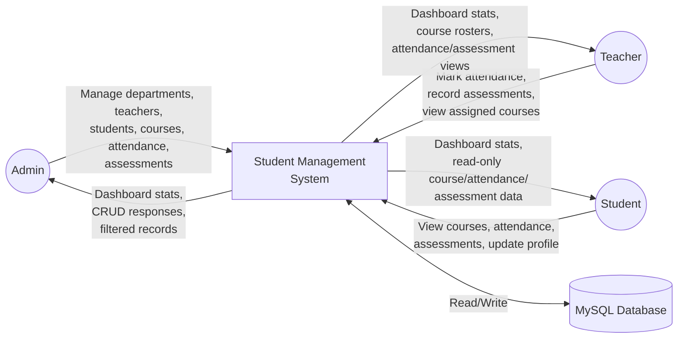

# Student Management System (SMS)

## 1. Project Overview

The **Student Management System (SMS)** is a web application that helps a college manage its academic records in one place. Admins, faculty and students each get their own portal to manage or view departments, courses, attendance and assessment marks.

### Features

#### Authentication & Role-Based Access Control (RBAC)
A single login page with a role selector. Each role has their own routes (`/admin`, `/teacher`, `/student`) are protected by dedicated middlewares, so any unauthorised access is not allowed. Passwords are hashed, and roles are assigned only on the server, never from form input.

#### Admin
Manages the master data: departments, students, faculty and courses (create, view, edit, delete), including assigning a faculty member to each course. Adding a student or faculty member creates their accounts. The admin can also review and correct attendance and assessment records submitted by faculties.

#### Faculty
Sees their assigned courses and the class list. Records attendance for a class and updates assessment marks.

#### Student
A dashboard showing their courses and overall attendance percentage. Read-only views of their courses, attendance history and assessment marks. Students can update their own phone number, date of birth, gender, address and password.

---

## 2. Technology Stack

| Layer | Technology Used |
| :--- | :--- |
| Backend | PHP |
| Framework | Laravel |
| Database | MySQL |
| Frontend | Blade Templates, Vanilla CSS |
| Authentication | Laravel Session Auth |
| Package Manager | Composer |

---

## 3. Directory and File Structure

```
student_management_sys/
├── app/
│   ├── Console/Commands/
│   │   └── CreateAdminCommand.php            # Artisan command to create admin user
│   ├── Http/
│   │   ├── Controllers/
│   │   │   ├── Controller.php                # Base controller
│   │   │   ├── Admin/
│   │   │   │   ├── DashboardController.php   # Admin dashboard stats
│   │   │   │   ├── CourseController.php       # Course CRUD
│   │   │   │   ├── DepartmentController.php  # Department CRUD
│   │   │   │   ├── StudentController.php     # Student CRUD
│   │   │   │   └── TeacherController.php     # Teacher CRUD
│   │   │   ├── Auth/
│   │   │   │   └── LoginController.php       # Login / Logout
│   │   │   ├── Student/
│   │   │   │   ├── DashboardController.php   # Student dashboard, courses, attendance, assessments
│   │   │   │   └── ProfileController.php     # Student profile update
│   │   │   └── Teacher/
│   │   │       ├── DashboardController.php   # Teacher dashboard and course views
│   │   │       ├── AttendanceController.php  # Attendance listing, create, store, edit, update, destroy
│   │   │       └── AssessmentController.php  # Assessment CRUD
│   │   ├── Middleware/
│   │   │   ├── EnsureUserIsAdmin.php         # Restricts routes to admin role
│   │   │   ├── EnsureUserIsTeacher.php       # Restricts routes to teacher role
│   │   │   └── EnsureUserIsStudent.php       # Restricts routes to student role
│   │   └── Requests/
│   │       ├── StoreAssessmentRequest.php
│   │       ├── StoreAttendanceRequest.php
│   │       ├── StoreCourseRequest.php
│   │       ├── StoreDepartmentRequest.php
│   │       ├── StoreStudentRequest.php
│   │       ├── UpdateAssessmentRequest.php
│   │       ├── UpdateCourseRequest.php
│   │       ├── UpdateDepartmentRequest.php
│   │       ├── UpdateStudentProfileRequest.php
│   │       └── UpdateStudentRequest.php
│   ├── Models/
│   │   ├── Assessment.php
│   │   ├── Attendance.php
│   │   ├── Course.php
│   │   ├── Department.php
│   │   ├── Student.php
│   │   ├── Teacher.php
│   │   └── User.php
│   └── Providers/
│       └── AppServiceProvider.php
├── bootstrap/
│   └── app.php                               # Middleware alias registration
├── database/
│   ├── migrations/
│   │   ├── create_users_table.php
│   │   ├── create_cache_table.php
│   │   ├── create_jobs_table.php
│   │   ├── create_departments_table.php
│   │   ├── create_teachers_table.php
│   │   ├── create_students_table.php
│   │   ├── create_courses_table.php
│   │   ├── create_attendances_table.php
│   │   └── create_assessments_table.php
│   └── seeders/
│       ├── DatabaseSeeder.php                # Runs all seeders below in order
│       ├── AdminSeeder.php                   # Admin account (only if none exists)
│       ├── DepartmentSeeder.php
│       ├── TeacherSeeder.php
│       ├── CourseSeeder.php
│       ├── StudentSeeder.php
│       ├── AttendanceSeeder.php
│       └── AssessmentSeeder.php
├── resources/
│   └── views/
│       ├── layouts/
│       │   └── app.blade.php                 # Master layout with role-based top navigation
│       ├── auth/
│       │   └── login.blade.php               # Login page
│       ├── components/
│       │   ├── flash-message.blade.php       # Success/error flash messages
│       │   └── form-error.blade.php          # Inline field validation errors
│       ├── admin/
│       │   └── dashboard.blade.php
│       ├── departments/
│       │   ├── index, create, edit, _form
│       ├── teachers/
│       │   ├── index, create, edit, show, _form
│       ├── students/
│       │   ├── index, create, edit, show, _form
│       ├── courses/
│       │   ├── index, create, edit, show, _form
│       ├── attendance/
│       │   ├── index, create, edit
│       ├── assessments/
│       │   ├── index, create, edit, _form
│       ├── student/
│       │   ├── dashboard.blade.php
│       │   ├── courses.blade.php
│       │   ├── attendance.blade.php
│       │   ├── assessments.blade.php
│       │   └── _profile_edit_form.blade.php
│       └── teacher/
│           └── dashboard.blade.php
├── routes/
│   └── web.php                               # All application routes
├── public/
│   ├── css/app.css                           # Stylesheet (CSS variables, role themes, layout)
│   └── index.php                             # Web entry point
└── .env                                      # Environment configuration
```

---

## 4. Data Flow



---

## 5. Installation and Setup Guide

### Prerequisites
- PHP `^8.3` 
- Composer `^2.0`
- MySQL `^8.0`

### Steps

1. **Clone the repository:**
   ```bash
   git clone https://github.com/iamPulakesh/Student_management_system_LARAVEL.git
   cd Student_management_system_LARAVEL
   ```

2. **Install PHP dependencies:**
   ```bash
   composer install
   ```

3. **Configure the database** in `.env`:
   ```ini
   DB_CONNECTION=mysql
   DB_HOST=127.0.0.1
   DB_PORT=3306
   DB_DATABASE=university_sms
   DB_USERNAME=root
   DB_PASSWORD=
   ```

4. **Generate the application key:**
   ```bash
   php artisan key:generate
   ```

5. **Run database migrations:**
   ```bash
   php artisan migrate
   ```

6. **Create the initial admin account:**
   ```bash
   php artisan app:create-admin
   ```
   This interactive command prompts for name, email, and password. It prevents creating a duplicate admin unless the `--force` flag is used.

7. **Seed the demo data (optional):**
   ```bash
   php artisan db:seed
   ```
   This fills the database with sample records so the application can be tested right away.

8. **Start the development server:**
   ```bash
   php artisan serve
   ```
   The application will be available at `http://127.0.0.1:8000` unless we set different port.
